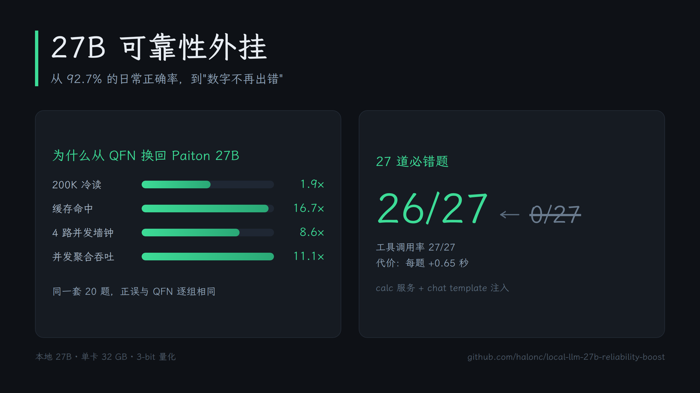

# Making a local 27B model reliable on numbers

> One 32 GB GPU, a 27B model quantised to 3-bit, and a home-made test suite.
> Why we switched back from a 176B model, where the 27B actually failed, and how moving arithmetic out of the model fixed 26 of 27 previously-broken cases.

[中文版](README.zh.md) · [Architecture](assets/arch-960x540.png)



## TL;DR

| | Result |
|---|---|
| Why switch back to 27B 3-bit | 1.9× faster cold 200K prefill, 16.7× faster cache hit, 11.1× higher aggregate throughput at 4 concurrent requests; **identical per-group accuracy** vs the 176B on the same 20-task suite |
| 27B baseline accuracy | 92.7% on 110 everyday-math tasks, 75.7% on 70 advanced-math tasks |
| Root cause of failures | **Zero of 26 failures were arithmetic** — all were wrong formulas, semantics, unit chains, or boundary definitions |
| Fix | Move all computation to a persistent `calc` service; write the discipline into the chat template |
| Outcome | 26/27 broken cases fixed (96%), tool-call rate 27/27 |

## 1. Why we moved from 176B back to 27B 3-bit

We had run a 176B MoE model (Qwen3.8-Flash-Next, IQ3_XXS, ~6B activated per token) on the same port for a month. The intuition was simple: more parameters, broader knowledge.

In practice it felt "maybe a little smarter", but **the speed was unbearable**. We ran a controlled comparison: 20 tasks covering 200K long-context reading, engineering drawing OCR, 4-way concurrency, engineering maths, code, and structured output — same prompts, same max_tokens, thinking disabled.

### 1.1 Speed

| Metric | 176B (MoE, 3-bit) | **27B (3-bit)** | Ratio |
|---|---|---|---|
| Cold 200K TTFT | 176.3 s | **91.3 s** | 1.9× |
| 200K second pass (cache hit) | 28.4 s | **1.7 s** | **16.7×** |
| 4-way concurrency, wall clock | 36.8 s | **4.3 s** | 8.6× |
| Aggregate throughput at 4 concurrent | 9.7 tok/s | **107.6 tok/s** | **11.1×** |
| Total time for 20 tasks | 5.7 min | **2.3 min** | 2.5× |

The concurrency row is the decisive one. The 176B model's four requests had TTFTs of **0.7 / 8.4 / 17.6 / 25.4 s** — the fourth request waited 25 seconds for its first token. That is queueing, not concurrency. The 27B's four requests came back at 0.1 / 0.6 / 0.6 / 0.7 s — genuinely parallel.

For a workflow that runs an agent while chatting, this is not a comfort issue. It decides whether the setup is usable at all.

### 1.2 Is 3-bit good enough?

The concern was obvious: going from 176B to 27B, then compressing to 3-bit, must cost something.

Same 20 tasks, per group:

| Group | 176B | **27B 3-bit** |
|---|---|---|
| 200K long context (3) | 3/3 | 3/3 |
| Engineering drawing OCR (6) | 6/6 | 6/6 |
| 4-way concurrency (4) | 4/4 | 4/4 |
| Engineering maths (3) | 2/3 | 2/3 |
| Code (2) | 0/2 | 0/2 |
| Structured output (2) | 1/2 | 1/2 |
| Manual review | 19/20 | 18/20 |

**Every group is identical.** The 0/2 and 1/2 entries are an artefact of strict keyword scoring — manually both models got them right.

In other words: on this task distribution the 176B offered no advantage, while the 27B was an order of magnitude faster. That is the justification for switching back.

### 1.3 The new problem

The 27B's absolute numbers looked fine: **102/110 (92.7%) everyday, 53/70 (75.7%) advanced maths**.

But the failures were of the worst kind for engineering work — **one wrong digit invalidates the whole answer**:

| Task | Correct | Model said | Error |
|---|---|---|---|
| Steel section weight (119.8 cm²) | 94.0 kg/m | **28.1** | 3.3× off |
| Formwork material volume | 417.9 m² | **2010 m²** (added 1990 wrong) | arithmetic slip |
| "This Friday" from a Tuesday | 10-23 | **10-24** | one day off |
| 3×3 determinant | −3 | **0** | could not expand |
| Complex product, real part | 8 | **−4** | sign error |

The common thread: **it is not that the model misunderstands the task** — it is that the final number is wrong. It knows which formula to use and still falls over on the last step.

## 2. Diagnosis: 26 failures, none of them arithmetic

First step was to quantify *where* it fails. The method was crude but reliable: every reference answer was computed **by Python**, never by the model itself, then results were tallied per category.

### 2.1 A counter-intuitive finding

The assumption was "harder operations fail more often". The data said otherwise:

| Category | Accuracy |
|---|---|
| Length / area / volume / mass conversion | **15/15** |
| Percentages, discounts, tax | **25/25** |
| Power consumption, speed, density | **15/15** |
| **Tip splitting** | **2/5** (the worst) |
| Temperature conversion | 4/5 |
| Ratios, weighted average, compound interest, dates | 4/5 each |
| Advanced maths, 14 categories | 53/70 |

**The "simplest" category was the worst.** Tip splitting is compound: percentage, division, rounding — one slip and the whole answer is wrong.

### 2.2 What the 26 failures actually were

| Failure mode | Example |
|---|---|
| **Wrong formula** | Weighted average reduced to a plain average; 1:2:4 mix used 2.4/3 instead of 2.4×2/7 |
| **Semantic drift** | "How much does each person pay" computed as something else entirely |
| **Boundary definition** | Date difference inclusive or not; sample vs population variance (n vs n−1) |
| **Unit chain** | Scale drawing 45 m at 1:1000 answered 45 cm instead of 4.5 cm |
| **Sign / omission** | Negative temperatures; chain rule missing a factor; distribution sign |

**Not one of them was plain arithmetic.** That conclusion determined the whole approach.

## 3. Approach: take arithmetic out of the model

Two options:

1. **Make the model better at arithmetic** — bigger model, chain of thought, few-shot
2. **Stop letting it touch numbers** — externalise all computation

We chose the second: **arithmetic can be outsourced, formula selection cannot**. And the failures clustered exactly on formula selection and semantics — the part "being better at arithmetic" would not fix.

Two layers remain:

```
Layer 1  Model: read the question, pick a subcommand + arguments   ← never touches digits
Layer 2  calc : Decimal + sympy, produce every number              ← never touches meaning
```

An earlier design had three layers (everyday / advanced / templates). That turned out to be meaningless — everything routes to `calc` anyway. Collapsing to two layers left one rule: **pick the right subcommand, do not compute**.

## 4. Implementation: argument tolerance is the real work

`calc` is a Python service (systemd, sympy imported once):

```bash
calc eval "4827+3916"                    # 8743
calc tip 240 20 3                        # 96.00
calc diff "x**2*exp(x)" --at 1           # 8.155
calc det "[[1,2,3],[4,5,6],[7,8,10]]"    # -3
calc stat "2,4,4,4,5,5,7,9" --ddof 0     # variance 4.00
```

The time sink was not computation — it was **the model's wildly varied calling conventions**:

| What the model sent | How we handled it |
|---|---|
| `{"cmd":"add","argv":["4827","3916"]}` | added `add/sub/mul/div` aliases |
| `eval "sqrt((3-6)^2+...)"` | expression parser accepts sqrt/abs/log/exp/sin/cos/pi, treats `^` as power |
| `det "[[1,2,3],[4,5,6]]"` | matrix accepts JSON arrays, semicolons, and newlines |
| `integ "x^2+1" 0 2` | integration accepts positional bounds |
| `stat "3,5,7,9 std"` | statistics recognise std/variance/population/sample and ignore stray words |
| `binom 10 4 0.3` | auto-detects n/p/k in any order |
| `wavg 80 90 70 3 2 1` | auto-detects "values then weights" |
| `solve "x**2-2*x-1=0"` | strips the trailing `=0` |
| malformed arguments | prints "bad arguments + correct usage" so the model can self-correct |

This table is the most reusable part of the article: **any tool you expose to a model must assume the caller ignores your documentation.**

## 5. Four more weaknesses, same idea

Arithmetic was just the most painful one. Four other chronic issues got the same treatment:

| Weakness | Symptom | Tool |
|---|---|---|
| **Hallucination** | invented paths, function names, URLs | `claim_verify`: extract path/function/URL claims, check with `ls` / `grep` / `HEAD`, require retraction on failure |
| **Lost in the middle** | facts in the middle of a 200K document missed | `longdoc_scan`: split by section, rank by keyword overlap, locate before reading closely |
| **Broken JSON** | missing commas, extra prose, renamed fields | `json_guard`: extract → repair (trailing commas, single quotes, bare keys) → schema validate → generate retry prompt |
| **Cannot say "I don't know"** | confident, well-formatted wrong answers | inject today's date and a "state uncertainty" rule into every turn |

**Honest labelling**: the arithmetic part was measured on 27 tasks (0/27 → 26/27). These four are "implemented and plausible" — **no A/B measurement**.

## 6. Injection: making it actually use the tool

A good tool is useless if the model ignores it. First measurement: only 9 of 27 tasks called the tool on their own.

The fix was to put the discipline **into the chat template** — not into a prompt the user must remember to paste:

```jinja

{{- "<|im_start|>system\n" + CALC_RULE + "<|im_end|>\n" }}
```

Changing the template rather than the client means it **applies to every caller**: whichever agent connects, with or without tool declarations, the model sees the same constraint.

Verified the crude way: asking the model to repeat the rule from its system prompt, which it does verbatim.

## 7. Deployment: three artefacts

```
docker-compose.yml          # model service, port unchanged
chat_template_calc.jinja    # discipline baked into the template
calc.service (systemd)      # computation, sympy resident
```

Dead ends we walked through:

- **Adding a proxy layer** that intercepts tool calls — worked, but violated "keep it simple"; removed
- **Changing the port** (model to 8090, proxy on 8080) — every client config had to change; removed
- Final state: **no port change, no middle layer**, template only

`calc` runs as a systemd service rather than a process inside the model container because it serves every client (this host, the NAS, containers on the NAS) and should not be tied to one model container's lifetime. Measured cross-host call: **42 ms**.

## 8. Pitfalls

1. **`-e VAR=` (empty string) ≠ `-e VAR` (unset)** — ROCm reads an empty device variable as "zero GPUs" and dies at startup with an error that looks like a code bug
2. **350 ms of sympy import per invocation** — moving to a resident service took 540 ms down to 42 ms
3. **The model wrote `{"cmd":"add"}` for `a+b`** — aliases plus an explicit "use eval for arithmetic" line in the tool description
4. **The model called the tool again after getting the result** — added "answer immediately, do not call again" to the template
5. **Scoring took the first number in the answer** — question text numbers came first, so 14.0 was scored against −10; changed to "any number within tolerance"
6. **Unicode minus sign `−` not recognised** — `−1` and `-1` are different characters
7. **Both 3×3 determinants answered 0** — the model cannot expand them at all; not an arithmetic slip
8. **Complex multiplication distribution** — 3i×(−2i) computed as −6 instead of +6
9. **Port changes and proxy layers were both dead ends** — ended up changing nothing but the template

## 9. Results

27 previously-broken tasks, **26 fixed (96%)**, tool-call rate **27/27**:

| Category | Fixed |
|---|---|
| Tip splitting | 3/3 |
| Temperature | 2/2 |
| Ratio mixing | 1/1 |
| Weighted average | 1/1 |
| Compound interest | 1/1 |
| Date arithmetic | 1/1 |
| Scale drawings | 1/1 |
| Derivatives | 3/3 |
| Definite integrals | 1/1 |
| Determinants | 2/2 |
| Matrices | 2/2 |
| Probability | 2/2 |
| Statistics | 2/2 |
| Vectors | 2/2 |
| Complex numbers | 2/2 |
| Polynomials | 0/1 (passes in isolation twice; intermittent empty response in batch) |

Cost: **+0.65 s per task** (one extra round trip plus tool execution). Absolute latency 0.78 s per task — imperceptible.

## 10. The reusable recipe

To repeat this on another model:

1. **Quantify the weakness**: build your own task suite; compute reference answers in code, never let the model self-certify
2. **Attribute by category**: tally accuracy per category and look for the counter-intuitive losers (here: tips worst, unit conversion perfect)
3. **Freeze the interface**: turn formulas into subcommands, **and assume the caller ignores the docs**
4. **Inject the discipline**: put it in the chat template, do not rely on client goodwill

**Can be outsourced**: arithmetic, unit conversion, date maths, matrices/integrals/statistics
**Cannot be outsourced**: formula selection, task interpretation, boundary definitions (inclusive or not; sample or population)

The latter only yields to template freezing — write the formula for each category, let the model fill in parameters.

---

*All figures come from three self-built suites (110 + 70 + 10 tasks) and a re-run of 27 historically failing tasks. Raw JSON lives in `bench/results/`.*
